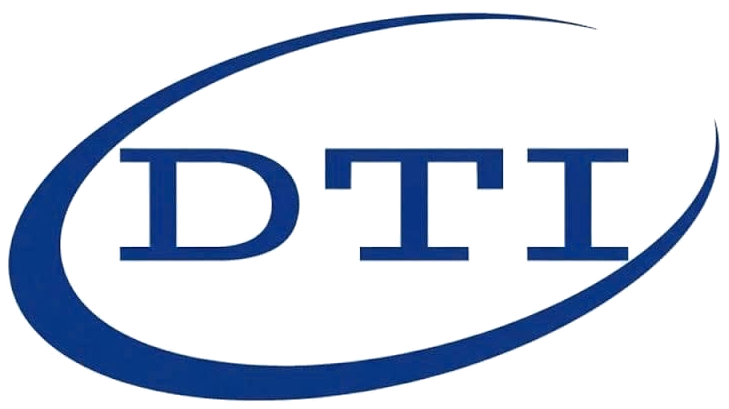

  
  <h1>DTWare</h1>
  
Inventory and operations management system

<h4>
    <a href="http://localhost:8000/">View Demo</a>
   · 
    <a href="http://localhost:8000/api-doc/">API Documentation</a>
   · 
    <a href="http://localhost:8000/admin/">Admin</a>
  </h4>

<!-- About the Project -->
## :star2: About the Project

DTWare provides inventory, stock, purchasing, sales, manufacturing, reporting, barcode and operations management features. The backend is built on Python/Django and exposes a REST API for external integrations.

<!-- Roadmap -->
### :compass: Roadmap

Product roadmap and customer-specific requirements should be tracked in the DTWare project workspace.

<!-- Integration -->
### :hammer_and_wrench: Integration

DTWare is designed to be **extensible**, and provides multiple options for **integration** with external applications or custom plugins:

* DTWare REST API
* Python integration layer
* Plugin interface
* Barcode, label, import and export workflows

<!-- TechStack -->
### :space_invader: Tech Stack

  
Server

  <ul>
    <li><a href="https://www.python.org/">Python</a></li>
    <li><a href="https://www.djangoproject.com/">Django</a></li>
    <li><a href="https://www.django-rest-framework.org/">DRF</a></li>
    <li><a href="https://django-q.readthedocs.io/">Django Q</a></li>
    <li><a href="https://docs.allauth.org/">Django-Allauth</a></li>
  </ul>

Database

  <ul>
    <li><a href="https://www.postgresql.org/">PostgreSQL</a></li>
    <li><a href="https://www.mysql.com/">MySQL</a></li>
    <li><a href="https://www.sqlite.org/">SQLite</a></li>
    <li><a href="https://redis.io/">Redis</a></li>
  </ul>

  
Client

  <ul>
    <li><a href="https://react.dev/">React</a></li>
    <li><a href="https://lingui.dev/">Lingui</a></li>
    <li><a href="https://reactrouter.com/">React Router</a></li>
    <li><a href="https://tanstack.com/query/">TanStack Query</a></li>
    <li><a href="https://github.com/pmndrs/zustand">Zustand</a></li>
    <li><a href="https://mantine.dev/">Mantine</a></li>
    <li><a href="https://icflorescu.github.io/mantine-datatable/">Mantine Data Table</a></li>
    <li><a href="https://codemirror.net/">CodeMirror</a></li>
  </ul>

DevOps

  <ul>
    <li>Docker</li>
    <li>PostgreSQL</li>
    <li>Redis</li>
    <li>Gunicorn</li>
    <li>Caddy / Nginx reverse proxy</li>
  </ul>

<!-- Getting Started -->
## 	:toolbox: Deployment / Getting Started

There are several options to deploy DTWare.

<h4>
    <a href="contrib/container/docker-compose.yml">Docker</a>
     · 
    <a href="contrib/deploy/supervisord.conf">Supervisor</a>
     · 
    <a href="setup_mac_bare_metal.sh">Bare Metal</a>
</h4>

Use the deployment files in this repository as the starting point for a customer environment. Production deployments must define the final domain, database credentials, SMTP configuration, backups, media storage and HTTPS proxy settings.

<!-- Mobile App -->
## 	:iphone: Mobile App

DTWare is optimized for desktop and tablet usage. Mobile browser access is available for compatible workflows.

<h4>
    <a href="http://localhost:8000/">Open DTWare</a>
</h4>

<!-- Security -->
## :lock: Code of Conduct & Security Policy

The DTWare project team is committed to providing a safe and reliable environment for all users. Please read our [Code of Conduct](CODE_OF_CONDUCT.md) for more information.

DTWare follows industry best practices for security. The security policy is included in [SECURITY.md](SECURITY.md).

<!-- Contributing -->
## :wave: Contributing

Contributions should follow the internal DTWare development and review process.

<!-- Translation -->
## :scroll: Translation

Native language translation of the DTWare web application can be maintained through the locale files in this repository.

<!-- Sponsor -->
## :money_with_wings: Sponsor

Customer support and sponsorship information should be provided through DTWare commercial channels.

<!-- Acknowledgments -->
## :gem: Acknowledgements

We want to acknowledge [PartKeepr](https://github.com/partkeepr/PartKeepr) as a valuable predecessor and inspiration.
Find a full list of used third-party libraries in the license information dialog of your instance.

## :heart: Support

For support, deployment assistance or customer-specific customization, contact the DTWare delivery team.

<!-- License -->
## :warning: License

Distributed under the [MIT](https://choosealicense.com/licenses/mit/) License. See [LICENSE.txt](LICENSE) for more information.
